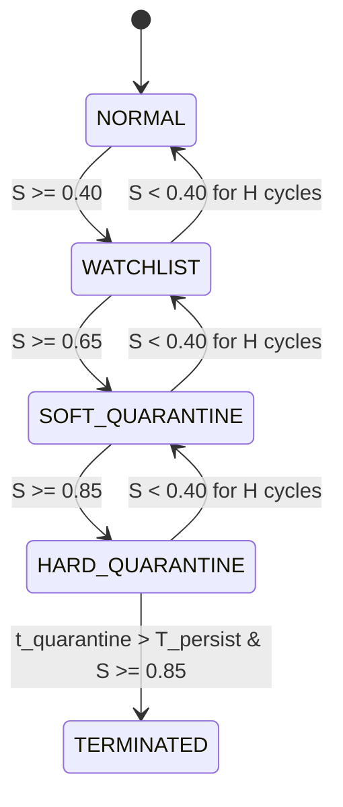

# Mathematical & Algorithmic Foundations of ARQ

## 1. Multi-Vector Telemetry Representation

At time $t$, each tracked process $p \in \mathcal{P}$ is characterized by an observation vector:

$$\mathbf{x}_p(t) = \begin{bmatrix} u_{cpu}(t) \\ \Delta m_{rss}(t) \\ m_{rss}(t) \\ io_{total}(t) \\ \beta_{burst}(t) \end{bmatrix}$$

where:
- $u_{cpu}(t) \in [0, 100\%]$: Instantaneous CPU core utilization.
- $\Delta m_{rss}(t) = \frac{m_{rss}(t) - m_{rss}(t - \Delta t)}{\Delta t}$ (MB/s): Rate of physical memory RSS growth.
- $m_{rss}(t)$ (MB): Total physical memory footprint.
- $io_{total}(t) = io_{read}(t) + io_{write}(t)$ (KB/s): Combined block I/O throughput.
- $\beta_{burst}(t)$: Burst volatility index measuring deviation from short-term baseline.

---

## 2. Exponentially Weighted Moving Average (EWMA) Baselining

To dynamically track long-term behavior without retaining infinite history buffers, ARQ updates historical baselines $\boldsymbol{\mu}_p(t)$ using an EWMA filter with smoothing coefficient $\alpha \in (0, 1]$ (default $\alpha = 0.25$):

$$\boldsymbol{\mu}_p(t) = \alpha \cdot \mathbf{x}_p(t) + (1 - \alpha) \cdot \boldsymbol{\mu}_p(t - 1)$$

---

## 3. Individual Vector Anomaly Scoring Functions

### 3.1 CPU Sigmoidal Scoring
Rather than a sharp step function, CPU strain is mapped using a continuous sigmoidal response centered at target threshold $\tau_{cpu}$ (default 75%):

$$S_{cpu}(u) = \frac{1}{1 + e^{-(u - \tau_{cpu}) / \sigma_{cpu}}}$$

### 3.2 Memory Rate & Footprint Scoring
Memory exhaustion manifests in two forms: rapid runaway allocation (leaks/fork bombs) and excessive static retention. ARQ scores both:

$$S_{mem\_rate} = \min\left(1.0, \frac{\Delta m_{rss}}{\tau_{\Delta m}}\right)$$
$$S_{mem\_abs} = \min\left(1.0, \frac{m_{rss}}{\tau_{m\_max}}\right)$$
$$S_{mem} = \max\left(S_{mem\_rate}, 0.70 \cdot S_{mem\_abs}\right)$$

### 3.3 I/O Thrashing Scoring
Disk saturation is bounded by the storage subsystem throughput limit $\tau_{io}$ (default 10 MB/s):

$$S_{io} = \min\left(1.0, \frac{io_{total}}{\tau_{io}}\right)$$

### 3.4 Transient Burst Volatility Filter
To distinguish benign spikes (e.g., compilers, crypto signers) from sustained cryptominers:

$$S_{burst} = \min\left(1.0, \frac{|u_{cpu}(t) - \mu_{cpu}(t)|}{\sigma_{burst}}\right)$$

---

## 4. Composite Anomaly Score Formulation

The global anomaly score $S_p(t) \in [0.0, 1.0]$ is computed as the convex combination:

$$S_{raw}(t) = w_c \cdot S_{cpu} + w_m \cdot S_{mem} + w_{io} \cdot S_{io} + w_b \cdot S_{burst}$$

$$\sum_{k \in \{c, m, io, b\}} w_k = 1.0 \quad (w_c = 0.40, w_m = 0.35, w_{io} = 0.15, w_b = 0.10)$$

### Burst Suppression Window:
If the consecutive anomalous cycle counter $C_{anom} < K_{burst}$ (where $K_{burst} = 3$), the effective score is dampened:

$$S_{eff}(t) = \begin{cases} 
0.65 \cdot S_{raw}(t) & \text{if } C_{anom} < K_{burst} \text{ and } S_{raw} < 0.90 \\
S_{raw}(t) & \text{otherwise}
\end{cases}$$

---

## 5. Graduated Quarantine & Hysteresis State Machine

Processes transition across stages governed by score thresholds $\Theta = \{\theta_{rec}=0.40, \theta_{soft}=0.65, \theta_{hard}=0.85\}$:

### Hysteresis Recovery:
To eliminate rapid oscillation (chattering) between states, demotion requires:

$$\sum_{i=0}^{H - 1} \mathbb{I}(S_{eff}(t - i) < \theta_{rec}) = H \quad (H = 4)$$
